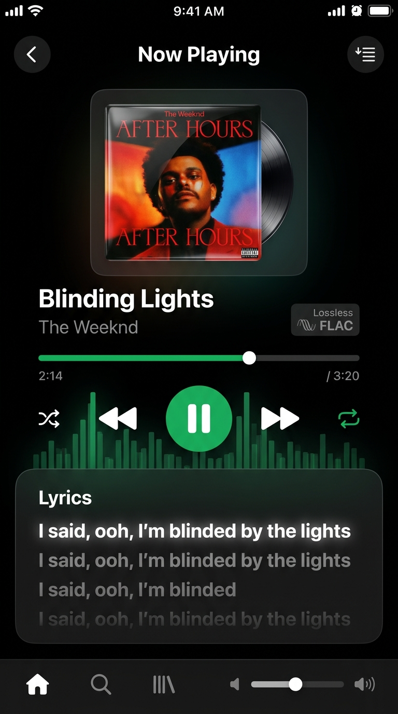
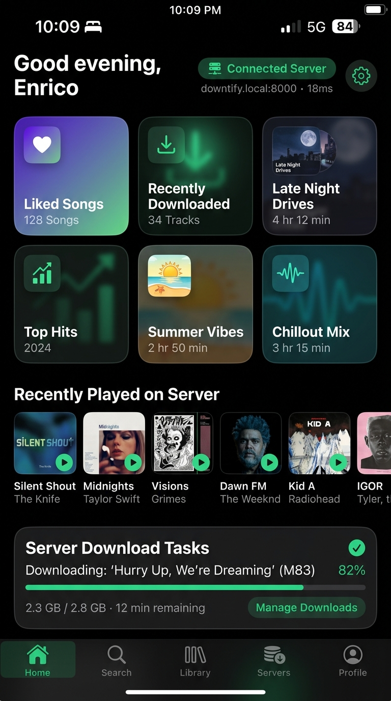
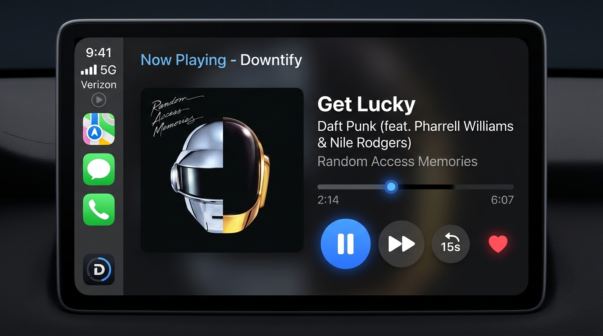

# Downtify iOS

> **The Native iOS Companion Client for Downtify**  
> An iOS port of [henriquesebastiao/downtify-android](https://github.com/henriquesebastiao/downtify-android), written natively in **Swift 6 & SwiftUI** with **Apple CarPlay** support, background audio playback, offline caching, and live time-synced lyrics.

---

## 📖 Overview

**Downtify iOS** pairs directly with your personal self-hosted [Downtify Server](https://github.com/henriquesebastiao/downtify). Instead of streaming from commercial subscription services, your phone streams directly from your personal, self-hosted music library in lossless FLAC or high-bitrate formats.

This application is engineered as a **100% native iOS application** (not a web wrapper), utilizing Apple's modern frameworks:
- **SwiftUI**: Responsive declarative interface with Cupertino animations and Dynamic Island integration.
- **AVFoundation (`AVPlayer` & `AVAudioSession`)**: True background audio playback under `.playback` mode with audio ducking and AirPlay support.
- **MediaPlayer (`MPNowPlayingInfoCenter` & `MPRemoteCommandCenter`)**: Native Lock Screen, Control Center, Dynamic Island, Apple Watch, and AirPods hardware controls.
- **CarPlay Framework (`CPTemplateApplicationSceneDelegate`)**: Full Apple CarPlay automotive dashboard interface with `CPTabBarTemplate`, `CPListTemplate`, and `CPNowPlayingTemplate`.
- **URLSession Background Downloader**: Downloads audio files directly to the iOS sandbox Documents directory (`UIFileSharingEnabled`) for offline playback without network access.

---

## 📸 Screenshots & Showcase

| iOS 18 Now Playing & Lyrics | Server Companion Home |
|:---:|:---:|
|  |  |
| *Auto-centering synchronized lyrics & FLAC stream* | *Server pairing status, quick mixes & active tasks* |

### Apple CarPlay In-Vehicle Dashboard
<p align="center">
  
  <br/>
  <em>Apple CarPlay CPTemplateApplicationScene automotive interface with driving-safe controls</em>
</p>

---

## ✨ Features & Capabilities

### 1. Server Pairing & Authentication
- **QR Code Pairing**: Connects instantly to your self-hosted Downtify instance by scanning the QR code displayed on the server under **Settings → Apps**.
- **Manual Login**: Connect via Server URL (`https://downtify.yourdomain.com`), Username, and Auth Token / Password.
- **Demo Mode**: Built-in mock self-hosted server for instant evaluation without requiring immediate server deployment.

### 2. Apple CarPlay Automotive Integration
- **Driving-Safe Interface**: Compliant with Apple's automotive interface standards with high-contrast, oversized touch targets.
- **CarPlay Tabs**:
  - **Now Playing**: Fullscreen automotive media view with large artwork, scrub bar, previous/next, 15s skip, and heart toggle.
  - **Home**: Quick driving mixes including Liked Songs and Recently Played on the server.
  - **Library**: Downloaded offline music and server playlists.
- **Entitlement & Delegation**: Built with `com.apple.developer.carplay-audio` and `CPTemplateApplicationSceneDelegate`.

### 3. Streaming & Offline Caching
- **Adaptive Bitrates**:
  - **Wi-Fi Streaming**: Original Quality (Lossless 24-bit FLAC / 320 kbps MP3).
  - **Cellular Streaming**: Data Saver Mode (128 kbps / 192 kbps) to conserve mobile data.
- **Offline Storage**: Tap the download icon on any song, album, or playlist to cache it in the iPhone's sandbox filesystem (`/Documents/Music`).
- **Offline Only Toggle**: Switch the library into "Offline Mode" to only show tracks saved locally on the device.
- **Cache Management**: Monitor storage consumption (e.g. `142 MB cached`), download all Liked Songs in one tap, or clear cache.

### 4. Apple Music-Grade Player with Live Time-Synced Lyrics
- **Auto-Centering Synced Lyrics**: Karaoke-style lyrics (fetched via LRCLIB) that automatically scroll the active line to the vertical center of the screen as playback progresses.
- **Tap-to-Scrub**: Tap any lyric line to jump playback directly to that second.
- **Dynamic Island**: Displays album artwork and animated frequency bars when playing, or real-time download percentages when caching.
- **Taptic Engine**: Haptic feedback clicks powered by `UIImpactFeedbackGenerator`.

### 5. iOS 18 & Latest iOS Compatibility
- **iOS 18 Control Center Widgets**: Built with `WidgetKit` & `AppIntents` (`ControlWidgetButton`), letting users toggle playback or skip tracks right from the iOS 18 customizable Control Center or the Action Button.
- **Apple Privacy Manifest (`PrivacyInfo.xcprivacy`)**: Full compliance with Apple's mandatory privacy requirements for iOS 17.4+ and iOS 18 App Store submissions. Declares zero tracking, zero third-party telemetry, and explicit reasons for `UserDefaults`, `FileTimestamp`, and `DiskSpace` APIs.
- **Dynamic Island & Live Activities (`ActivityKit`)**: `DowntifyNowPlayingActivityAttributes` powers Lock Screen and Dynamic Island live updates on iPhone 14 Pro, 15, 15 Pro, 16, and 16 Pro models.
- **AirPods Route Change & Interruption Handling**: Automatically pauses playback when AirPods disconnect or headphones are unplugged (`.oldDeviceUnavailable`), and smoothly resumes after phone calls with `.shouldResume`.
- **Local Network Access (`NSLocalNetworkUsageDescription`)**: Fully compliant with iOS Local Network security requirements for streaming lossless audio from home servers (e.g. `downtify.local:8000` or `192.168.x.x`).
- **Swift 6 Concurrency**: Architecture marked with `@MainActor` and `Sendable` types for zero data race warnings under the Swift 6 compiler.

### 6. Security, Keychain & Privacy Hardening
- **iOS Keychain Secure Storage**: Server auth tokens and session keys are secured in Apple's hardware-backed Keychain using `kSecClassGenericPassword` with `kSecAttrAccessibleAfterFirstUnlockThisDeviceOnly`, protecting credentials from unencrypted backups and unauthorized extraction.
- **App Transport Security (ATS) Local Networking**: Complies with Apple ATS standards using `NSAllowsLocalNetworking: true` for private home lab IPs (`192.168.x.x`, `10.x.x.x`, `.local`) while maintaining strict TLS 1.3/1.2 validation for external domains without dangerous arbitrary load bypasses.
- **Apple Privacy Manifest (`PrivacyInfo.xcprivacy`)**: Zero third-party trackers, zero advertising SDKs, and clean API rationale declarations matching App Store guidelines.

---

## 🏛️ Native iOS Source Structure (`/ios/Downtify/`)

```
ios/Downtify/
├── DowntifyApp.swift                    # SwiftUI @main entry point (iOS 18 & Swift 6)
├── PrivacyInfo.xcprivacy                # Apple Privacy Manifest (Mandatory for iOS 17.4+ / 18)
├── Info.plist                           # Background modes, CarPlay scenes, LAN permissions
├── Intents/
│   └── DowntifyAppIntents.swift         # iOS 18 Control Center widgets & App Intents
├── LiveActivity/
│   └── NowPlayingActivityAttributes.swift # ActivityKit Dynamic Island & Live Activities
├── Models/
│   ├── Track.swift                      # Track, LyricLine, and Playlist structs
│   └── ServerModels.swift               # ServerConnectionInfo, QRAuthPayload, Task models
├── Services/
│   ├── KeychainHelper.swift             # iOS Keychain secure token storage
│   ├── DowntifyAPIService.swift         # URLSession REST client for Downtify server
│   ├── AudioPlayerService.swift         # AVPlayer, Route change listener & MPRemoteCommands
│   └── DownloadManager.swift            # URLSession background offline downloader
├── CarPlay/
│   ├── CarPlaySceneDelegate.swift       # CPTemplateApplicationSceneDelegate
│   └── CarPlayTemplateManager.swift     # CPTabBarTemplate, CPListTemplate & CPNowPlayingTemplate
└── Views/
    ├── MainTabView.swift                # 4-tab native navigation & persistent mini player
    ├── HomeView.swift                   # Server status banner, Liked Songs card, Quick 6-grid
    ├── SearchView.swift                 # Library search & server-side URL downloader
    ├── LibraryView.swift                # Offline switch, playlists, albums, and tracks
    ├── SettingsView.swift               # Audio quality, offline storage & server config
    ├── NowPlayingView.swift             # Fullscreen player with auto-centering lyrics & AirPlay
    └── ServerPairingView.swift          # Camera QR viewfinder & manual server login
```

---

## 🛠️ Step-by-Step Setup & Instructions

### A. Pairing with your Downtify Server
1. Ensure your Downtify server (`henriquesebastiao/downtify`) is running (e.g. via Docker).
2. On your computer or tablet, open your Downtify Web interface and navigate to **Settings → Apps**.
3. Launch **Downtify iOS** on your device.
4. Tap **Scan QR Code** and align the camera with the QR code displayed on the server.
5. Your library, playlists, and favorites will automatically sync to your iOS device.

### B. Building & Running in Xcode
1. Open the project in **Xcode 16+** (targeting iOS 18.0+).
2. Set your **Development Team** under *Signing & Capabilities*.
3. Verify that the following capabilities are active:
   - **Audio, AirPlay, and Picture in Picture** (Background Modes)
   - **Background fetch** (Background Modes)
   - **CarPlay Audio Application** (`com.apple.developer.carplay-audio`)
4. Select an **iPhone 16 Pro** or **CarPlay Simulator** destination.
5. Press **Cmd + R** to build and run.

### C. Running the Web Preview in AI Studio
```bash
# Start local dev server
npm run dev

# Run TypeScript linter
npm run lint

# Compile production bundle
npm run build
```

---

## 🚗 CarPlay Configuration Details

In `Info.plist`, the CarPlay scene is declared under `UIApplicationSceneManifest`:
```xml
<key>UISceneConfigurations</key>
<dict>
    <key>CPTemplateApplicationSceneSessionRoleApplication</key>
    <array>
        <dict>
            <key>UISceneConfigurationName</key>
            <string>CarPlay Configuration</string>
            <key>UISceneDelegateClassName</key>
            <string>$(PRODUCT_MODULE_NAME).CarPlaySceneDelegate</string>
        </dict>
    </array>
</dict>
```
When your iPhone connects to a vehicle via lightning, USB-C, or Wireless CarPlay, `CarPlaySceneDelegate` initializes and hands off audio control to the in-dash screen.

---

## 📜 Credits & License

- Based on [downtify-android](https://github.com/henriquesebastiao/downtify-android) and [downtify](https://github.com/henriquesebastiao/downtify) by **Henrique Sebastião**.
- Ported to iOS with Swift 6, SwiftUI, AVFoundation, and CarPlay.
- Licensed under the Apache-2.0 License.
